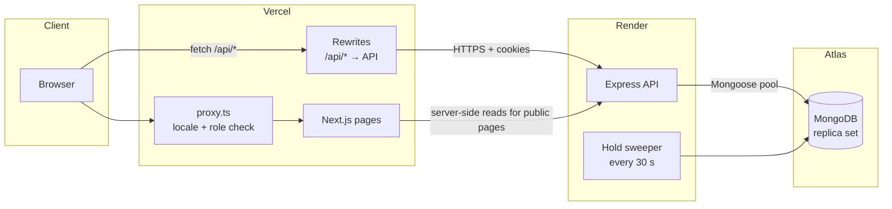
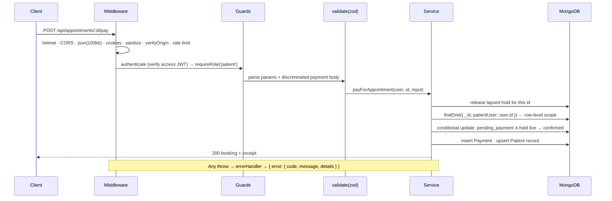
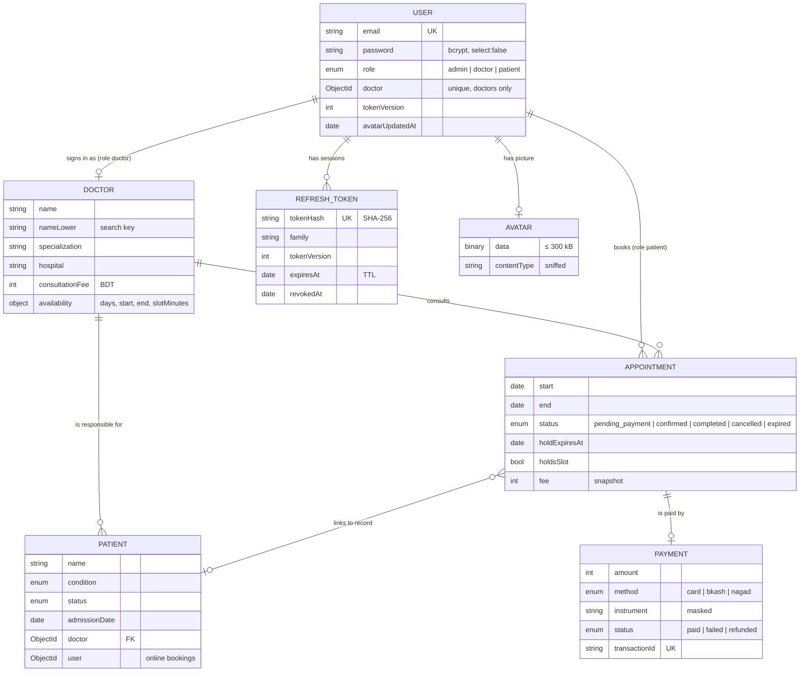
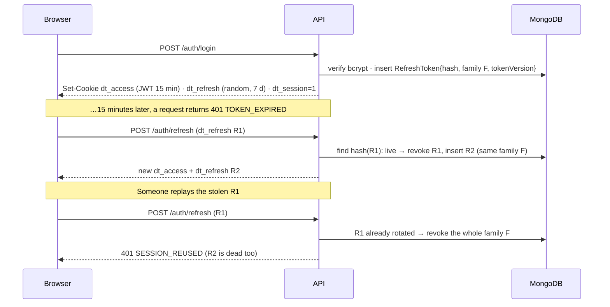
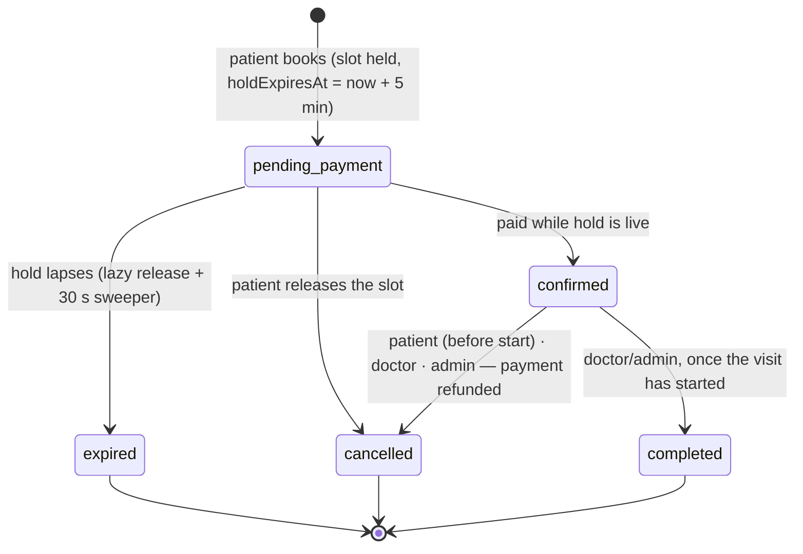

# Architecture — Doctor Tracker API

How the API is put together and why. For setup and the endpoint list see [README.md](./README.md).

- [1. System context](#1-system-context)
- [2. Layered design](#2-layered-design)
- [3. Request lifecycle](#3-request-lifecycle)
- [4. Data model](#4-data-model)
- [5. Roles & access control](#5-roles--access-control)
- [6. Sessions](#6-sessions)
- [7. Scheduling, booking & payment](#7-scheduling-booking--payment)
- [8. Indexing strategy](#8-indexing-strategy)
- [9. Query patterns](#9-query-patterns)
- [10. Dashboard aggregation](#10-dashboard-aggregation)
- [11. Validation & error handling](#11-validation--error-handling)
- [12. Security controls](#12-security-controls)
- [13. Testing strategy](#13-testing-strategy)
- [14. Deployment](#14-deployment)
- [15. Scalability considerations](#15-scalability-considerations)

---

## 1. System context



The frontend and API are separate deployments. Browsers never call the API host directly: they call `/api/*` on the frontend origin and Next.js rewrites to Render, which makes the session cookies first-party (see [§6](#6-sessions)). The frontend's server also reads the public endpoints to prerender indexable pages.

## 2. Layered design

```
routes/        → URL, middleware chain and required role, declared side by side
controllers/   → read req.validated + req.user, call a service, shape the response
services/      → all database logic, business rules and row-level scoping
validators/    → zod schemas: the contract for body / query / params
models/        → Mongoose schemas and indexes
middlewares/   → authentication, role guards, ownership guards, CSRF, limits, errors
config/        → env (validated at boot), DB connection, roles / statuses / constants
utils/         → query helpers and timezone helpers
```

- **Controllers never touch Mongoose; services never see `req`/`res`.** Services take the caller (`AuthUser`) where scoping matters, so the same `listAppointments` serves patients, doctors and admins with different filters.
- **Lean reads + explicit DTOs**: `id` instead of `_id`, no internal fields (`nameLower`, `holdsSlot`, password hashes, token versions).
- **`createApp()` is a factory** without a DB connection, so tests mount the production app against an in-memory MongoDB.

## 3. Request lifecycle



Express 5 forwards rejected promises to the error middleware natively — no `try/catch` wrappers.

## 4. Data model



Key choices:

- **One login per roster entry.** A doctor's `User` points at its `Doctor` document (`doctor`, partial unique index), so the access token carries `doctorId` and ownership checks need no lookup.
- **Patients are both accounts and records.** A *patient account* books appointments; a *patient record* is a clinical entry in one doctor's list. A paid booking **upserts** the record for `(user, doctor)` (partial unique index), so repeat visits reuse it.
- **Fee snapshot.** The appointment stores the fee at booking time; later fee changes don't rewrite history.
- **Avatars outside the user document**, in their own collection: free-tier disks are ephemeral, and user reads never carry image bytes.

## 5. Roles & access control

Three layers, from coarse to fine:

1. **Route guards** — every route in `routes/index.ts` is annotated with who may call it: `public`, `signedIn`, `admin`, `doctor`, `patient`, or `adminOrOwningDoctor`.
2. **Ownership guards** — `requireDoctorScope('id')` lets admins through and a doctor only when `:id` is their own roster entry (403 otherwise).
3. **Row-level scoping in services** — appointment and payment queries always merge a scope filter (`{}` for admins, `{ doctor: user.doctorId }`, `{ patientUser: user.id }`); patient-record updates by doctors are filtered by `{ doctor: user.doctorId }`. A row outside the scope looks like **404**, so ids can't be probed.

Other rules: only admins reassign a patient to another doctor; only patients book and pay; registration never accepts `role` (zod strips unknown keys and the service forces `patient`).

## 6. Sessions



- **Access token**: HS256 JWT with `iss`, `aud`, `sub`, `role`, `doctorId`, `typ: access`; verified statelessly on every request.
- **Refresh token**: 256-bit random, stored only as a **SHA-256 hash** with its family, user agent and IP; TTL index deletes expired rows.
- **Rotation + reuse detection** as above; a **30-second grace** returns `REFRESH_RACE` (no revocation) when two tabs refresh at once — the frontend retries with the cookie the winning tab already received.
- **Revocation**: logout revokes the family; password change and "sign out everywhere" bump `tokenVersion` and revoke all families, so other devices drop off within one access-token lifetime.
- **Cookies**: `httpOnly`, `SameSite=Lax`, `Secure` in production, path `/`. A third cookie, `dt_session=1`, is readable by JavaScript and holds no secret: it only lets the frontend skip session calls for visitors.
- **Timing-safe login**: unknown emails still run a bcrypt comparison, and both failure modes return the same message.

## 7. Scheduling, booking & payment

### Schedules and slots

A doctor's `availability` is wall-clock time in the clinic timezone (`Asia/Dhaka`): consulting days (0 = Sunday), start, end and slot length (15–60 min). `slot.service` turns it into UTC instants per calendar date with a small `Intl`-based timezone helper (no date library), drops past slots, and marks a slot taken when a **confirmed** booking or a **still-live hold** exists — one indexed range query per request on `{ doctor, start }`. The booking window is 30 days.

### Booking state machine



Guarantees:

- **No double booking.** `holdsSlot` is `true` only for `pending_payment` and `confirmed`. A **partial unique index** `{ doctor: 1, start: 1 }` with `partialFilterExpression: { holdsSlot: true }` lets MongoDB reject a second live booking of the same slot atomically, under any concurrency.
- **Released means released.** Before any slot read or booking, lapsed holds are flipped to `expired` with `holdsSlot: false` (indexed `{ status, holdExpiresAt }`); the sweeper does the same every 30 seconds. The slot is immediately bookable by everyone.
- **One open hold per patient.** A patient with an unpaid booking is pointed back to it (`409 OPEN_HOLD`) instead of grabbing several slots.
- **Late payments can't confirm.** Confirmation is a conditional `findOneAndUpdate` on `status = pending_payment ∧ holdExpiresAt > now`.
- **Published slots only.** A booking's `start` must match one of the doctor's generated slot starts.

### Simulated payments

`chargeInstrument` behaves like a gateway without moving money: Luhn check, expiry check, card brand detection and a deterministic **decline for `4000 0000 0000 0002`**; bKash/Nagad accept 11-digit BD mobile numbers with a 4–6 digit PIN. Every attempt is stored (`paid` or `failed` with a reason) with a unique transaction id and a **masked instrument** (`Visa •••• 4242`) — full numbers and PINs are never stored. A declined attempt keeps the hold so the patient can retry. Cancelling a paid booking marks the payment `refunded`.

## 8. Indexing strategy

Indexes follow **ESR** (Equality → Sort → Range) so one index serves filter, sort and pagination.

| Collection | Index | Serves |
|---|---|---|
| doctors | `{ email: 1 }` unique | uniqueness, email-prefix search |
| doctors | `{ nameLower: 1 }` | name-prefix search (admin + public directory) |
| doctors | `{ specialization: 1, createdAt: -1 }` · `{ hospital: 1, createdAt: -1 }` · `{ createdAt: -1 }` | filters + default sort |
| patients | `{ doctor: 1, admissionDate: -1 }` | a doctor's list; per-page patient counts |
| patients | `{ condition: 1, admissionDate: -1 }` · `{ status: 1, admissionDate: -1 }` · `{ admissionDate: -1 }` | filters, date ranges, dashboard |
| patients | `{ nameLower: 1 }` · `{ email: 1 }` sparse | search (every `$or` branch indexed) |
| patients | `{ user: 1, doctor: 1 }` unique, partial | one record per (account, doctor) |
| appointments | `{ doctor: 1, start: 1 }` unique, partial (`holdsSlot: true`) | **double-booking guard** |
| appointments | `{ doctor: 1, start: -1 }` · `{ patientUser: 1, start: -1 }` · `{ status: 1, start: -1 }` | schedules, "my appointments", admin list |
| appointments | `{ status: 1, holdExpiresAt: 1 }` | hold sweeper |
| payments | `{ transactionId: 1 }` unique · `{ doctor: 1, paidAt: -1 }` · `{ status: 1, paidAt: -1 }` · `{ patientUser: 1, createdAt: -1 }` | revenue, receipts |
| users | `{ email: 1 }` unique · `{ doctor: 1 }` unique partial · `{ role: 1, createdAt: -1 }` | login, doctor link |
| refreshtokens | `{ tokenHash: 1 }` unique · `{ family: 1 }` · `{ user: 1 }` · `{ expiresAt: 1 }` TTL | rotation, revocation, cleanup |
| avatars | `{ user: 1 }` unique | one picture per user |

`autoIndex` is on in development and off in production, where `syncIndexes()` runs once at boot.

### Verified query plans

`npm run explain` against the seeded Atlas cluster:

```
Doctors: default list (newest first)       IXSCAN(createdAt_-1)                        docsExamined=10  returned=10
Doctors: search "dr. a"                    OR ← IXSCAN(email_1) + IXSCAN(nameLower_1)  docsExamined=5   returned=5
Doctors: filter by specialization          IXSCAN(specialization_1_createdAt_-1)       docsExamined=6   returned=6
Patients: default list (latest admission)  IXSCAN(admissionDate_-1)                    docsExamined=10  returned=10
Patients: by doctor                        IXSCAN(doctor_1_admissionDate_-1)           docsExamined=10  returned=10
Patients: condition filter                 IXSCAN(condition_1_admissionDate_-1)        docsExamined=10  returned=10
Patients: admission date range             IXSCAN(admissionDate_-1)                    docsExamined=10  returned=10
Patients: search "jo"                      OR ← IXSCAN(nameLower_1) + IXSCAN(email_1)  docsExamined=49  returned=10
```

## 9. Query patterns

- **Lists**: `find(filter).select().sort({ field, _id }).skip().limit().lean()` in parallel with `countDocuments(filter)`; `limit ≤ 100`, sort fields whitelisted, `_id` tie-breaker for stable pages.
- **Joins without N+1**: patient rows use one `populate` `$in` query per page; doctor rows get patient counts from one `$group` and login/photo status from one `users` `$in` query.
- **Search**: anchored prefix regex on normalized fields; the public directory also matches the name after the "Dr." title (`$in` of two anchored prefixes, still index bounds).
- **Writes**: partial `$set` with `runValidators`; doctor-scoped deletes filter by `{ _id, doctor }`; deleting a doctor cascades to their login, sessions, patients and appointments only after an explicit confirmation.

## 10. Dashboard aggregation

`GET /stats/overview` runs in parallel: O(1) `estimatedDocumentCount` totals, an index-range count for the previous period (trend %), new doctors in range, a `$group` of **appointments by status** in range, a `$group` sum of **paid revenue** in range, specialization counts, and one **`$facet`** over patients in range (timeline with `$dateTrunc`, condition/status/gender, `$bucket` age groups, top-10 doctors with the `$lookup` after `$limit`). Missing time buckets are zero-filled; responses carry `Cache-Control: private, max-age=30`. The doctor overview (`/me/doctor/overview`) uses the same approach scoped to one doctor.

## 11. Validation & error handling

Zod validates and coerces every input onto `req.validated` (Express 5's `req.query` is read-only). Payment bodies are a **discriminated union** on `method`. One error middleware maps failures to a consistent shape: `VALIDATION_ERROR` (400, field `details`), `UNAUTHORIZED` / `TOKEN_EXPIRED` (401), `FORBIDDEN` (403), `NOT_FOUND` (404), `CONFLICT` (409, with `details.reason` such as `SLOT_TAKEN`, `OPEN_HOLD`, `HOLD_EXPIRED`), `PAYMENT_DECLINED` (402), `PAYLOAD_TOO_LARGE` (413), `TOO_MANY_REQUESTS` (429), `INTERNAL_ERROR` (500; stack only outside production). The frontend maps codes to messages in Bangla or English.

Zod 4 applies defaults inside `.partial()`, so update schemas never carry defaults (a regression test covers it).

## 12. Security controls

- Passwords: bcrypt cost 12; policy ≥ 8 chars with a letter and a number; timing-safe login.
- Sessions: see [§6](#6-sessions).
- **CSRF**: SameSite=Lax cookies plus `verifyOrigin` — state-changing requests with a foreign `Origin` are rejected.
- **Rate limits**: 300 req/min per IP; failed logins 10 / 15 min keyed by IP + email; registration/refresh 60 / 15 min; bookings 10 / 10 min per account.
- **Input**: 100 kB JSON cap; `$`/`.` keys stripped; ObjectIds validated; regex input escaped.
- **Uploads**: raw image bodies capped at 300 kB; type decided by **magic bytes**, not the header; served with `nosniff` and the sniffed type.
- Headers: helmet; `x-powered-by` off; CORS allow-list with credentials.
- Payments: only masked instruments stored; no card numbers or PINs persisted.

## 13. Testing strategy

Integration tests over the real HTTP stack (Supertest → `createApp()` → Mongoose → mongodb-memory-server). Two suites, 42 tests: the original CRUD/search/aggregation suite and a roles-and-booking suite that walks registration, RBAC, the full booking/payment/expiry/refund cycle, session rotation and reuse detection, CSRF and avatar upload. Time-dependent behaviour (hold expiry, refresh grace) is exercised by moving timestamps in the database rather than sleeping.

## 14. Deployment

| Piece | Where | Notes |
|---|---|---|
| API | Render free web service, Singapore (`render.yaml`) | build `npm ci --include=dev && npm run build`, start `node dist/server.js`, health `/api/health`, auto-deploy from `main` |
| Database | MongoDB Atlas M0, AWS Mumbai | least-privilege app user (`readWriteAnyDatabase`); network access open for Render's dynamic IPs |
| Secrets | Render dashboard | `MONGODB_URI`, `JWT_SECRET`, `CLIENT_ORIGIN` — never committed |

Graceful shutdown stops the sweeper, drains connections and closes the pool on `SIGTERM`.

## 15. Scalability considerations

- **Stateless API**: access tokens are verified without a DB hit, so instances scale horizontally. Rate-limit counters and the hold sweeper are per instance today; with several instances the counters move to Redis and the sweeper stays idempotent (it's a conditional `updateMany`).
- **Double booking stays correct at any scale** because the guarantee is a database unique index, not application locking.
- **Pagination**: offset pagination today; keyset pagination on the existing `{ field, _id }` sort keys for very deep pages.
- **Search** moves to Atlas Search for fuzzy/infix matching.
- **Dashboard** can be pre-aggregated per day with `$merge` if traffic grows; analytics reads can use `secondaryPreferred`.
- **Real payments** slot in behind `chargeInstrument`: create a gateway intent at booking, confirm via webhook with the same conditional update, keep the hold semantics unchanged.
- **Avatars** move to object storage (S3/R2) by changing only `avatar.service`; URLs are already versioned and cache-friendly.
