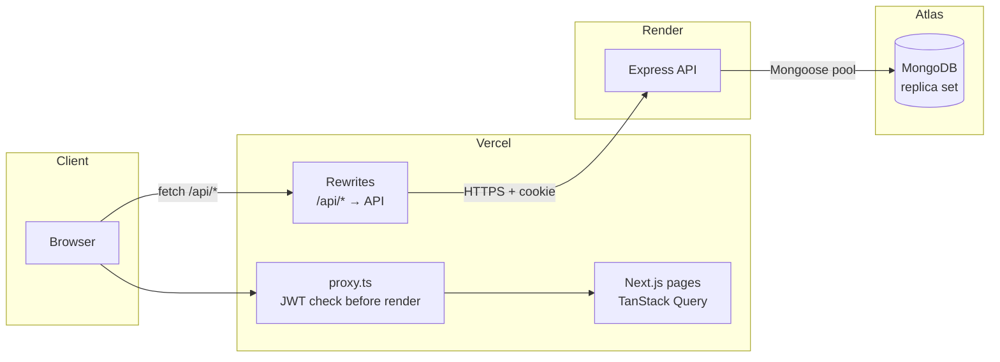
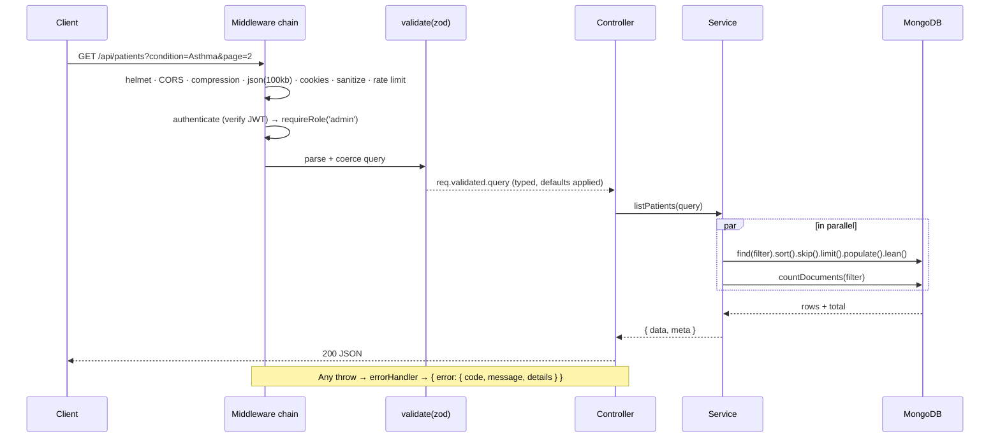
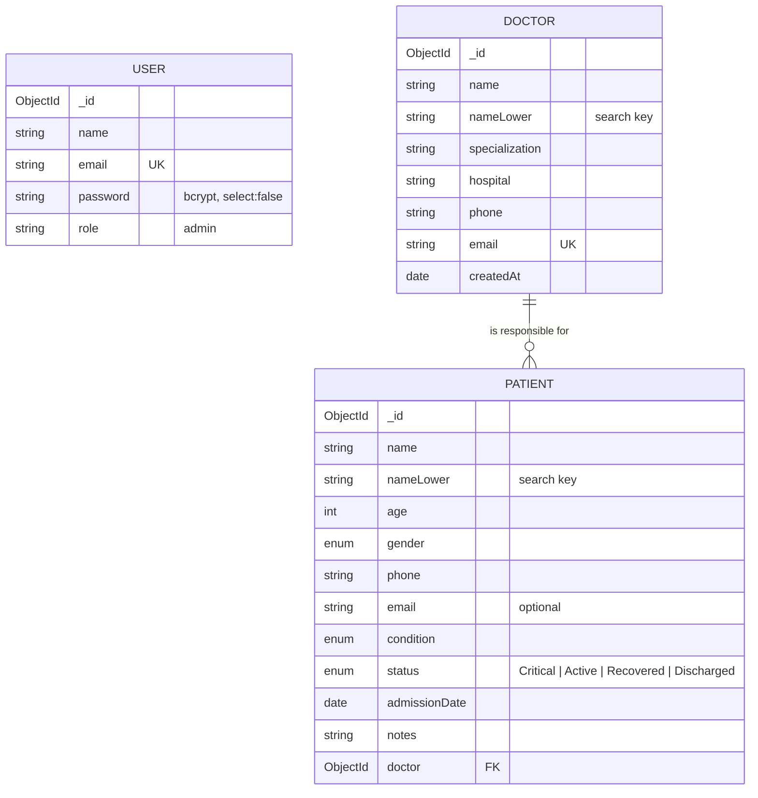

# Architecture — Doctor Tracker API

This document explains how the API is put together and why. For setup and the endpoint list see [README.md](./README.md).

- [1. System context](#1-system-context)
- [2. Layered design](#2-layered-design)
- [3. Request lifecycle](#3-request-lifecycle)
- [4. Data model](#4-data-model)
- [5. Indexing strategy](#5-indexing-strategy)
- [6. Query patterns](#6-query-patterns)
- [7. Dashboard aggregation](#7-dashboard-aggregation)
- [8. Authentication & authorization](#8-authentication--authorization)
- [9. Validation & error handling](#9-validation--error-handling)
- [10. Security controls](#10-security-controls)
- [11. Testing strategy](#11-testing-strategy)
- [12. Deployment](#12-deployment)
- [13. Scalability considerations](#13-scalability-considerations)

---

## 1. System context



The frontend and API are separate deployments. The browser never calls the API host directly: it calls `/api/*` on the frontend origin and Next.js rewrites those requests to Render. That single decision makes the auth cookie first-party (see [§8](#8-authentication--authorization)).

## 2. Layered design

```
routes/        → which URL, which middleware chain, which controller
controllers/   → read req.validated, call a service, shape the HTTP response
services/      → every database read/write and business rule
validators/    → zod schemas: the contract for body / query / params
models/        → Mongoose schemas, indexes, normalization plugin
middlewares/   → cross-cutting concerns (auth, validation, limits, errors)
config/        → env (validated at boot), DB connection, constants
```

Rules the code follows:

- **Controllers never touch Mongoose.** They are 3–5 lines each, so HTTP concerns (status codes, `Location` headers, cache headers) are easy to audit.
- **Services never see `req`/`res`.** They take typed inputs and return plain objects, which makes them reusable — `listPatients` serves both `/patients` and `/doctors/:id/patients`.
- **Services return serialized DTOs** (`id` instead of `_id`, no `__v`, no internal `nameLower`), using `.lean()` reads so no Mongoose document hydration cost is paid on list endpoints.
- **`createApp()` is a factory** that doesn't connect to the database, so tests mount the exact production app against an in-memory MongoDB.

## 3. Request lifecycle



Express 5 forwards rejected promises from async handlers to the error middleware natively, so there is no `try/catch` or `asyncHandler` wrapper anywhere.

## 4. Data model



- **Reference, not embed.** Patients reference their doctor (`doctor: ObjectId`). Embedding patients inside doctors would hit the 16 MB document limit for busy doctors, make "all patients" queries awkward, and turn every patient edit into a rewrite of the doctor document.
- **Enums for `condition` and `status`** keep filter values clean and make the dashboard breakdowns meaningful; they are enforced both by zod (400 with a field message) and by the schema.
- **`nameLower`** is a derived field kept in sync by `nameLowerPlugin` on `validate` (create/save) and on `findOneAndUpdate`/`updateOne` hooks, so no code path can forget it. It is `select: false` and stripped from JSON.

## 5. Indexing strategy

Indexes follow the **ESR rule** (Equality → Sort → Range): the equality field first, then the default sort field, so the same index serves the filter, the sort and the pagination window without an in-memory sort.

| Collection | Index | Serves |
|---|---|---|
| doctors | `{ email: 1 }` unique | uniqueness, email-prefix search |
| doctors | `{ nameLower: 1 }` | name-prefix search |
| doctors | `{ specialization: 1, createdAt: -1 }` | filter by specialization, newest first |
| doctors | `{ hospital: 1, createdAt: -1 }` | filter by hospital, newest first |
| doctors | `{ createdAt: -1 }` | default list order, "date added" range |
| patients | `{ doctor: 1, admissionDate: -1 }` | a doctor's patient list; per-page patient counts |
| patients | `{ condition: 1, admissionDate: -1 }` | condition filter + default sort |
| patients | `{ status: 1, admissionDate: -1 }` | status filter + default sort |
| patients | `{ admissionDate: -1 }` | default list order, date ranges, dashboard `$match` |
| patients | `{ nameLower: 1 }` | name-prefix search |
| patients | `{ email: 1 }` sparse | email-prefix search (every `$or` branch must be indexed) |
| users | `{ email: 1 }` unique | login lookup |

Index builds: `autoIndex` is on in development and off in production, where `syncIndexes()` runs once at boot — so production never builds indexes implicitly in the middle of traffic, and stale indexes are dropped.

### Verified query plans

`npm run explain` prints the winning plan for each hot query. Output against the seeded Atlas cluster (60 doctors, 3,000 patients):

```
Doctors: default list (newest first)       IXSCAN(createdAt_-1)                        docsExamined=10  returned=10
Doctors: search "dr. a"                    OR ← IXSCAN(email_1) + IXSCAN(nameLower_1)  docsExamined=5   returned=5
Doctors: filter by specialization          IXSCAN(specialization_1_createdAt_-1)       docsExamined=6   returned=6
Patients: default list (latest admission)  IXSCAN(admissionDate_-1)                    docsExamined=10  returned=10
Patients: by doctor                        IXSCAN(doctor_1_admissionDate_-1)           docsExamined=10  returned=10
Patients: condition filter                 IXSCAN(condition_1_admissionDate_-1)        docsExamined=10  returned=10
Patients: admission date range             IXSCAN(admissionDate_-1)                    docsExamined=10  returned=10
Patients: search "jo"                      OR ← IXSCAN(nameLower_1) + IXSCAN(email_1)  docsExamined=49  returned=10
```

No query performs a collection scan, and paginated lists examine exactly the documents they return.

## 6. Query patterns

**Lists** (`/doctors`, `/patients`, `/doctors/:id/patients`)

```ts
const [rows, total] = await Promise.all([
  Model.find(filter).select(projection).sort({ [field]: dir, _id: dir })
       .skip((page - 1) * limit).limit(limit).lean(),
  Model.countDocuments(filter),
]);
```

- `limit` is capped at 100; `sort` comes from a per-resource whitelist (no sorting on unindexed fields from user input).
- `_id` is appended to every sort as a tie-breaker so pages are stable when many rows share a timestamp.
- Patient rows need their doctor's name: `.populate('doctor', 'name specialization hospital')` issues **one** `$in` query for the whole page.
- Doctor rows need a patient count: **one** `$match { doctor: { $in: pageIds } } → $group` for the whole page (covered by the `{ doctor, admissionDate }` index). This avoids both N+1 queries and a denormalized counter that would need transactional upkeep.

**Search** is an anchored, case-sensitive prefix regex on the normalized field (`^jo` on `nameLower`), OR-ed with the email prefix. Anchored prefixes compile to index bounds; user input is regex-escaped. Trade-off and alternatives are discussed in the README's technical decisions.

**Filters** are plain equality or `$in` on enum fields, and `$gte/$lte` on dates. A bare `to` date (`2026-01-31`) is widened to the end of that day so the range is inclusive the way people expect.

**Writes**

- Partial updates use `$set` with only the fields provided; `runValidators: true` keeps schema rules on updates.
- `DELETE /doctors/:id/patients/:patientId` deletes with `{ _id, doctor }` as the filter, so the nested route can only remove a patient that belongs to that doctor (404 otherwise).
- Deleting a doctor with patients returns **409** with the count; the client can retry with `?cascade=true`, which deletes the doctor and their patients.

## 7. Dashboard aggregation

`GET /stats/overview?from&to&interval` runs six independent operations in parallel:

| # | Operation | Cost |
|---|---|---|
| 1 | `DoctorModel.estimatedDocumentCount()` | O(1) collection metadata |
| 2 | `PatientModel.estimatedDocumentCount()` | O(1) |
| 3 | `countDocuments` for the previous period (trend %) | index range on `admissionDate` |
| 4 | `countDocuments` doctors created in range | index range on `createdAt` |
| 5 | doctors `$group` by specialization | 60-row collection |
| 6 | **patients `$match` (range) → `$facet`** | one index-backed pass |

The `$facet` (#6) produces, from a single scan of the patients in range:

- `timeline` — `$group` by `$dateTrunc { unit: interval, startOfWeek: 'monday', timezone: 'UTC' }`
- `byCondition`, `byStatus`, `byGender` — `$group` + `$sort`
- `byAgeGroup` — `$bucket` with boundaries `0, 18, 30, 45, 60, 75+`
- `topDoctors` — `$group` by doctor (with a `$cond` count of critical patients) → `$sort` → `$limit 10` → `$lookup` doctor name/specialization. The lookup runs on 10 documents, not on every patient.

The service then fills missing time buckets with zeros so the chart's x-axis is continuous, picks a sensible interval when none is given (≤ 45 days → day, ≤ 180 → week, else month), and computes the period-over-period change. Responses carry `Cache-Control: private, max-age=30`.

## 8. Authentication & authorization

```mermaid
sequenceDiagram
    participant B as Browser
    participant N as Next.js (Vercel)
    participant A as API (Render)
    B->>N: POST /api/auth/login {email, password}
    N->>A: (rewrite) POST /api/auth/login
    A->>A: rate limit (IP+email) → zod → bcrypt.compare
    A-->>N: 200 + Set-Cookie dt_token=JWT; HttpOnly; Secure; SameSite=Lax
    N-->>B: 200 + cookie (first-party, frontend origin)
    B->>N: GET /patients (page)
    N->>N: proxy.ts verifies JWT signature + expiry (jose)
    N-->>B: page shell
    B->>N: GET /api/patients
    N->>A: (rewrite, cookie forwarded)
    A->>A: authenticate → requireRole('admin')
    A-->>B: 200 data
```

- **Password storage:** bcrypt, cost 12; the hash is `select: false` and never serialized.
- **Token:** HS256 JWT with `issuer`, `subject` and a 1-day expiry; the cookie's `maxAge` is derived from the token's own `exp − iat` so both expire together.
- **Two independent checks:** the frontend proxy verifies the cookie before rendering any protected page (no flash of protected UI, early redirect to `/login?next=…`), and the API verifies it again on every request — the proxy is a UX layer, the API is the security boundary.
- **Authorization:** `requireRole('admin')` guards everything after `/auth/login`. The role lives in the token, so the guard is a constant-time check with no DB round trip.
- **Login responses** use one generic message for "unknown email" and "wrong password" to prevent account enumeration.
- **Bearer support:** `Authorization: Bearer <token>` is accepted too, for API clients and tests.

## 9. Validation & error handling

Every route declares its contract with zod: `validate({ body, query, params })` parses, coerces (`"2"` → `2`, `"2026-01-31"` → `Date`), applies defaults and stores the result on `req.validated` (Express 5's `req.query` is read-only). Controllers only ever read validated data.

One error middleware maps every failure to the same shape:

| Source | Status | `code` |
|---|---|---|
| `ZodError` | 400 | `VALIDATION_ERROR` + `details: [{ field, message }]` |
| Mongoose `ValidationError` / `CastError` | 400 | `VALIDATION_ERROR` / `BAD_REQUEST` |
| Malformed JSON / body > 100 kB | 400 / 413 | `BAD_REQUEST` / `PAYLOAD_TOO_LARGE` |
| Missing / invalid token | 401 | `UNAUTHORIZED` |
| Wrong role | 403 | `FORBIDDEN` |
| Unknown id or route | 404 | `NOT_FOUND` |
| Duplicate key (E11000) | 409 | `CONFLICT` + `details.field` |
| Rate limit | 429 | `TOO_MANY_REQUESTS` |
| Anything else | 500 | `INTERNAL_ERROR` (stack only outside production) |

Field-level `details` let the frontend put server errors right under the matching input.

A Zod 4 subtlety worth noting: defaults apply even inside `.partial()` schemas, so `status` has no default on the shared patient schema — only the create schemas add `.default('Active')`. Otherwise every PATCH would silently reset the status (covered by a regression test).

## 10. Security controls

- `helmet` security headers; `x-powered-by` disabled.
- CORS allow-list from `CLIENT_ORIGIN` with credentials.
- Rate limits: 300 req/min per IP on `/api`, and 10 failed logins / 15 min keyed by **IP + email** (requests arrive via the frontend proxy, so IP alone would group unrelated users).
- `trust proxy` set to 1 hop for correct client IPs behind Render.
- Body size capped at 100 kB; keys starting with `$` or containing `.` are stripped from bodies (operator-injection defense in depth on top of zod's strict shapes).
- Every id is validated as an ObjectId before it reaches a query; regex input is escaped.
- Environment validated at boot (`JWT_SECRET` ≥ 32 chars, URI present) — misconfiguration fails fast instead of at the first request.

## 11. Testing strategy

Integration tests over the real HTTP stack (Supertest → `createApp()` → Mongoose → mongodb-memory-server). This tests what matters for an API — status codes, response shapes, auth, validation and query behaviour — without mocking the database.

## 12. Deployment

| Piece | Where | Notes |
|---|---|---|
| API | Render free web service (`render.yaml`) | build `npm ci --include=dev && npm run build`, start `node dist/server.js`, health `/api/health`, auto-deploy from `main` |
| Database | MongoDB Atlas M0 (AWS ap-south-1) | dedicated least-privilege DB user; network access open for Render's dynamic IPs |
| Secrets | Render dashboard | `MONGODB_URI`, `JWT_SECRET`, `CLIENT_ORIGIN` — never committed |

Graceful shutdown: on `SIGTERM`/`SIGINT` the server stops accepting connections, finishes in-flight requests, then closes the Mongo pool — which matters on Render, where deploys send `SIGTERM`.

## 13. Scalability considerations

What is in place, and what would change at larger scale:

- **Stateless API** — sessions are JWTs, so instances scale horizontally behind a load balancer with no sticky sessions. (Rate-limit counters are in memory per instance; with several instances they would move to Redis.)
- **Pagination** — offset (`skip`) pagination is simple and supports "jump to page N", and is fine at this size. For very deep pages on millions of rows the next step is **keyset (cursor) pagination** on the existing `{ field, _id }` sort keys, which the indexes already support.
- **Counts** — `countDocuments` on a filtered set is index-backed; at very large scale the UI would switch to "estimated" totals or cache counts per filter.
- **Search** — prefix search scales with the index. Fuzzy, infix or typo-tolerant search would move to **Atlas Search** (Lucene) rather than slower regexes.
- **Dashboard** — the `$facet` pass is bounded by the date range. For heavy traffic, the overview could be pre-aggregated per day into a small `daily_stats` collection (or a materialized view via `$merge`) and the endpoint would read ~365 tiny documents instead of scanning patients.
- **Reads vs writes** — Atlas replica sets allow `readPreference: secondaryPreferred` for the analytics endpoint if it ever competes with writes.
- **Multi-tenancy / roles** — `requireRole` already takes a role list; adding `viewer` or per-hospital scoping is a schema + guard change, not a rewrite.
